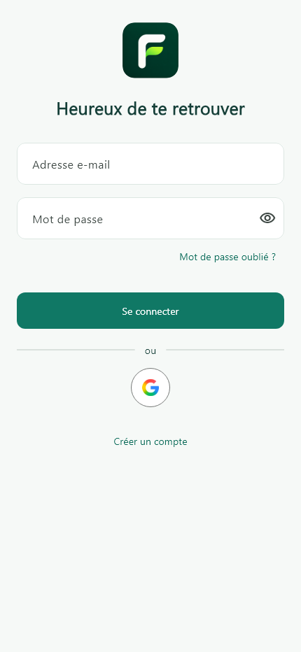
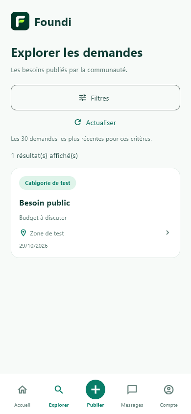
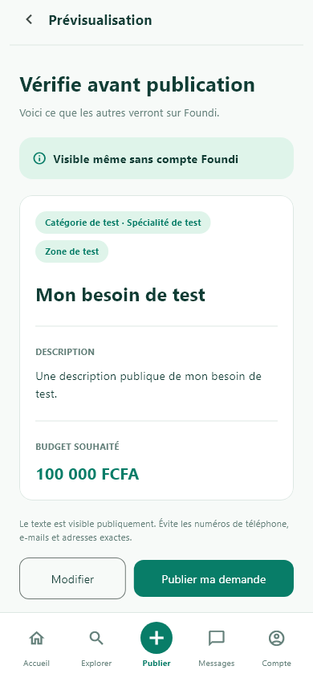
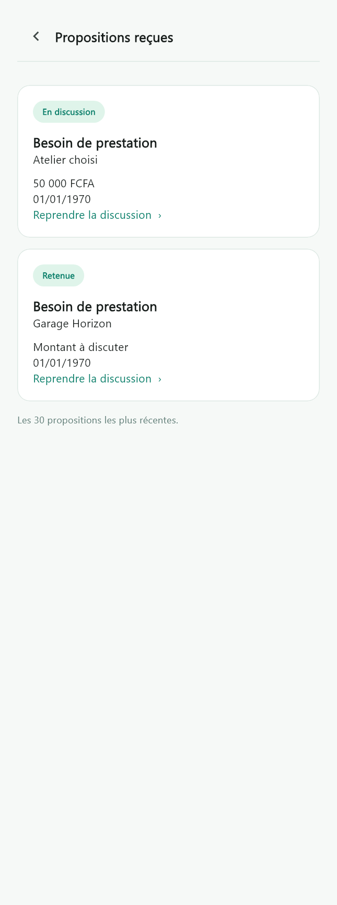
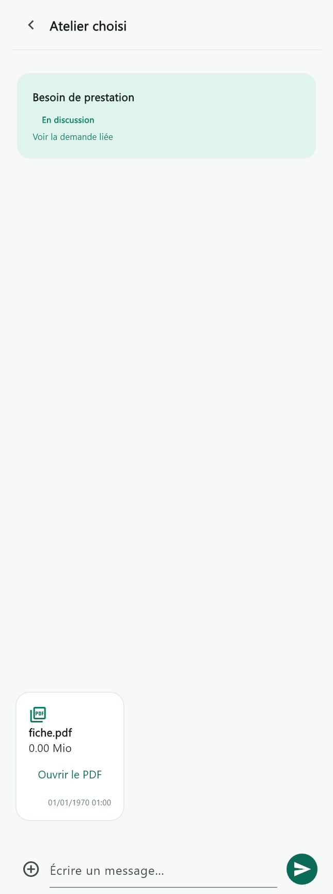
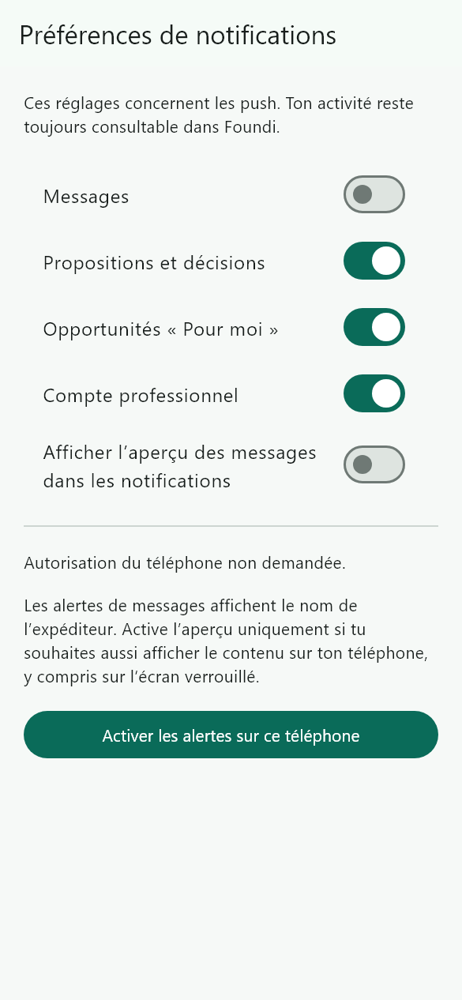

# Foundi

Foundi met en relation des particuliers qui publient un besoin et des professionnels vérifiés qui proposent leurs services. L’application repose sur Flutter, Firebase Authentication, Cloud Firestore, Cloud Storage, Cloud Functions et Firebase Cloud Messaging.

## Aperçu de l’application

Captures des écrans Flutter avec des données fictives.

| Connexion | Explorer sans compte | Aperçu avant publication |
| :---: | :---: | :---: |
|  |  |  |

| Propositions reçues | Discussion privée | Préférences de notifications |
| :---: | :---: | :---: |
|  |  |  |

## Parcours

- **Visiteur** — consulter et filtrer les demandes publiques dans Explorer.
- **Client** — créer un compte par e-mail ou avec Google, vérifier son adresse, publier une demande et la gérer dans **Mes demandes**. Comparer les propositions reçues, discuter en privé et choisir un professionnel.
- **Professionnel** — soumettre son dossier depuis le même compte. Après approbation, utiliser l’espace pro, consulter les opportunités « Pour moi » et envoyer des propositions privées.
- **Messagerie et notifications** — échanger des messages, des photos, des PDF et des coordonnées partagées volontairement. Les messages non lus et les notifications d’activité ont chacun leur compteur. Sur mobile, l’aperçu du contenu des messages dans les push est désactivé par défaut.
- **Administration** — examiner les dossiers professionnels et gérer les catégories, spécialités, zones et exigences documentaires dans [Foundi Admin](admin/README.md).

La publication exige une adresse e-mail vérifiée. Les limites s’appliquent par compte avec 60 secondes entre deux créations, 5 créations sur 24 heures et 20 sur 7 jours, en fenêtres glissantes. Voir la [sécurisation des publications V9.2](docs/publications-v9-2.md).

## Démarrer en local

Prérequis validés pour cette version — Flutter 3.44.3 (Dart 3.12.2) et Node.js 22. Pour les émulateurs, installer aussi la CLI Firebase et Java 21 ou supérieur.

Depuis la racine du dépôt, installer les dépendances puis démarrer les émulateurs avec un projet de démonstration.

```powershell
flutter pub get
npm.cmd --prefix functions ci
firebase emulators:start --project demo-foundi --only auth,firestore,functions,storage
```

Dans un deuxième terminal, lancer l’application sur un appareil Flutter disponible.

```powershell
flutter run --dart-define=USE_FIREBASE_EMULATORS=true
```

Le client utilise les ports 9099 pour Auth, 8080 pour Firestore et 5001 pour Functions. Storage écoute sur le port 9199. L’hôte par défaut est `10.0.2.2` sur l’émulateur Android et `localhost` sur les autres plateformes. Sur un téléphone physique, définir `--dart-define=FIREBASE_EMULATOR_HOST=ADRESSE_LAN_DU_PC`.

Pour préparer des références de test, suivre le [guide du catalogue partagé](docs/catalogue-et-validation.md). Pour tester l’envoi des codes e-mail, configurer le SMTP dans `functions/.env.local` et les secrets de développement dans `functions/.secret.local`. Les deux fichiers sont ignorés par Git.

### Configuration Firebase

Sans le mode émulateur, la configuration FlutterFire du dépôt cible le projet `foundi-7c837`. Pour configurer un environnement Firebase, activer les fournisseurs E-mail/Mot de passe et Google dans Authentication, puis préparer Firestore, Cloud Storage et Cloud Functions. Sur Android, enregistrer les empreintes SHA-1 et SHA-256 du certificat utilisé. Pour le Web, ajouter le domaine aux domaines autorisés dans Firebase Authentication.

Pour les codes e-mail, renseigner `SMTP_HOST`, `SMTP_PORT`, `SMTP_FROM` et `SMTP_REQUIRE_TLS=true` à partir de [l’exemple d’environnement](functions/.env.example). Stocker `SMTP_USER`, `SMTP_PASSWORD` et `OTP_HMAC_KEY` dans Secret Manager. La clé HMAC doit contenir au moins 32 caractères aléatoires.

## Vérifier les changements

```powershell
flutter analyze
flutter test
npm.cmd --prefix functions test
npm.cmd --prefix functions run check
npm.cmd --prefix functions run test:v92:emulators
```

La dernière commande lance les tests des règles et les scénarios d’intégration Firebase sur les émulateurs.

## Documentation

| Sujet | Guides |
| --- | --- |
| Comptes et profils professionnels | [Authentification](docs/authentification-v3.md) · [Catalogue et validation](docs/catalogue-et-validation.md) · [Administration](admin/README.md) |
| Demandes | [Publication](docs/demandes-v5.md) · [Cycle de vie](docs/demandes-v6.md) · [Filtres Explorer](docs/explorer-filtres-foun52.md) · [Quotas V9.2](docs/publications-v9-2.md) |
| Propositions et échanges | [Propositions privées](docs/propositions-v7.md) · [Négociation](docs/negociation-v8-1.md) · [Messagerie et pièces jointes](docs/messagerie-v8-2.md) |
| Notifications | [Centre de notifications](docs/notifications-v9.md) · [Badges et push](docs/badges-push-v9-1.md) |
