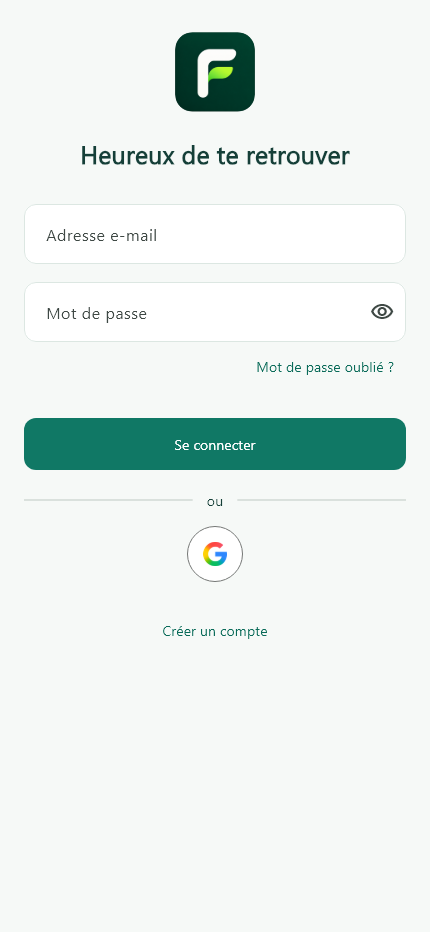

# Logo et connexion Foundi

Mise à jour du 4 novembre 2026 : logo fourni intégré aux icônes natives et aux
en-têtes, logo au-dessus de l'accueil de connexion, retrait du lien des anciens
comptes par code et du texte de connexion commun client/pro, bouton Google
compact avec son logo, tooltip et libellé accessible.

L'inscription, la récupération de mot de passe, les validations et les appels
d'authentification restent inchangés. Le logo source est conservé sans modification
dans `assets/branding/foundi-logo-source.png`. Les exports sont reproductibles avec
`node tool/prepare_branding.cjs` ; les sources Google sont indiquées dans
`assets/branding/README.md`.

Validation : 102/102 tests Flutter, analyse sans problème, contrôle visuel,
29 tailles d'icônes Apple et 7 tailles ICO vérifiées. Le contrôle de déconnexion
vérifie toujours la disparition du viewer et des images privées en mémoire,
tout en permettant l'affichage des nouveaux logos publics.

APK Android debug compilé : version **1.0.2 (3)**, **166 230 707 octets**,
`build/app/outputs/flutter-apk/app-debug.apk`. Les deux images de marque présentes
dans l'APK ont été comparées aux fichiers du projet.

SHA-256 : `f5a5d89991cccdb669b193cbf9adf542b528bea3ab35081214a0562ef4c8c210`.

L'APK est prêt à installer ; aucune installation distante ni publication en
boutique n'a été effectuée. Les ressources des autres plateformes sont préparées,
sans compilation iOS/macOS/Windows pour cette mise à jour.
