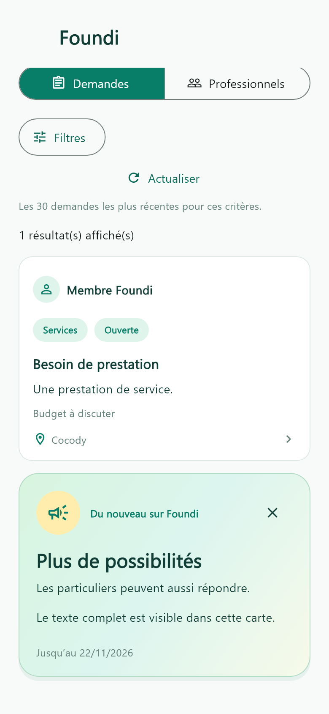

# Informations Foundi — version légère

Implémentation sur `codex/reponses-particuliers-badge-carte`.

## Parcours utilisateur

- Explorer affiche une carte chaleureuse après la première demande, ou dans le fil vide. La dernière annonce publiée et encore en cours est mise en avant, avec son titre, son introduction et son texte complet dans la même carte. Aucun bouton « Découvrir » ni écran de détail n’est nécessaire.
- La fermeture est mémorisée localement pour le compte et la version de l’annonce, avec au plus 40 petits identifiants conservés. Une nouvelle version peut être présentée de nouveau. Aucun état de lecture n’est écrit dans Firestore.
- `Compte → Informations Foundi` permet de retrouver les annonces en cours, même après fermeture de leur carte. Chaque annonce est lisible intégralement dans sa carte, sans navigation supplémentaire.
- L’explication du badge est permanente, intégrée dans l’application et entièrement contenue dans une carte, même si les annonces sont indisponibles. Sans annonce en cours, Explorer propose cette explication dans la carte chaleureuse, elle aussi refermable.
- Une annonce arrivée à échéance disparaît de la rubrique et son contenu n’est plus accessible par l’API publique. Sa carte est également retirée à l’échéance et son contenu est vérifié au retour de l’application au premier plan.
- Le contenu n’est pas tronqué. La carte adapte sa hauteur et utilise le défilement normal du fil. Un message court est recommandé pour une lecture rapide.

## Administration

La rubrique `Annonces Foundi` propose création, modification, brouillon, publication et archivage. Titre (100 caractères), résumé (240), contenu en texte simple (12 000) et date de fin sont obligatoires. La publication exige une fin future dans les 12 prochains mois. Le sélecteur fixe la fin à 23 h 59 min 59 s de la date choisie, dans le fuseau de l’ordinateur ; l’heure effective est affichée dans le formulaire et la liste.

Les annonces expirées et archivées restent dans la vue Archives de l’administration. L’expiration est calculée à la lecture : aucun traitement planifié n’est nécessaire. Une annonce peut être republiée après choix d’une nouvelle date. Une modification concurrente est refusée avec invitation à actualiser, sans écrasement silencieux.

L’admin charge 30 annonces par page, puis la suite à la demande. Les vues filtrent les pages chargées ; le bouton « Charger la suite » reste accessible s’il existe d’autres annonces. Le contenu des archives n’est jamais chargé par l’application utilisateur.

## Données et coût de chargement

- `foundiAnnouncements/{id}` : document complet privé, avec statut, date de fin et version.
- `foundiInformation/current` : registre privé des seuls résumés en cours, borné à 20 annonces. Les entrées expirées sont filtrées à chaque lecture et retirées du registre lors de la mutation suivante.
- `foundiInformationAudit/{id}` : auteur, date, versions et statut de chaque mutation administrative, écrits dans la même transaction.
- Quatre callables en `europe-west1` : `listFoundiInformation`, `readFoundiInformation`, `listAdminFoundiInformation`, `saveFoundiInformation`.
- Liste publique : une lecture de document pour les résumés. Le texte complet est récupéré automatiquement pour les cartes affichées, par l’API existante `readFoundiInformation` : une lecture supplémentaire par carte. Dans la rubrique du compte, la liste construit les cartes au fur et à mesure du défilement ; les 20 textes ne sont pas préchargés ensemble. Les contrôles communs de sécurité des callables s’ajoutent pour les comptes connectés.
- Aucun écouteur Firestore pour cette rubrique, aucune image d’annonce, aucun compteur de lecture, aucune notification push automatique. Explorer actualise à la réouverture, au plus une fois par minute, et au retour de l’application au premier plan. Une défaillance de cette lecture ne bloque pas les demandes. Une erreur temporaire de chargement du texte propose un nouvel essai dans la carte ; une annonce devenue indisponible est masquée.
- Les dates serveur servent à calculer le délai d’expiration local ; l’API reste l’autorité pour l’accès au contenu. Les accès directs Firestore sont refusés, y compris à un client admin. Les mutations et la liste admin vérifient les droits administratifs actuels dans Firebase Auth.

## Mise en service

Les quatre nouvelles Cloud Functions, les règles Firestore et l’administration web sont maintenant déployées sur `foundi-7c837`. L’admin est accessible sur [foundi-7c837.web.app](https://foundi-7c837.web.app). Une nouvelle version de l’application reste à diffuser pour rendre la carte et la rubrique disponibles aux utilisateurs. Aucun index composite supplémentaire ni migration des données existantes n’est nécessaire. Aucun contenu d’annonce n’est publié automatiquement ; l’admin crée la première annonce.

Voir le [compte rendu de déploiement et ses preuves](deploiement-informations-foundi.md).

L’ajustement du 21 novembre 2026 supprimant les pages de détail concerne uniquement l’application : il utilise les Cloud Functions déjà déployées, sans modification des règles ni de l’admin web.

## Validation

Tests dédiés :

- `functions/test/information-service.test.js` : états publics/privés, échéances, droits admin révoqués, conflits, validation et capacité bornée.
- `functions/integration-test/information-flow.test.cjs` : véritables transactions et pagination Firestore, expiration et refus des lectures/écritures directes pour invités, membres et admins. Commande : `node functions/scripts/test-v82-emulators.cjs --safety-only --information-only`.
- `test/information_test.dart` : délégation du repository réel, persistance locale de la fermeture, texte complet dans les cartes sans nouvelle route, badge permanent hors ligne depuis le compte, expiration, reprise après erreur et chargement progressif des textes, sans bloquer Explorer.
- `admin/test/information_test.dart` : publication avec version/date, archives, refus d’une republication avec date passée, validation et gestion des conflits.

Pour l’ajustement du 21 novembre : 19 tests Flutter ciblés réussis, dont les 7 tests de cette rubrique et 12 scénarios Explorer. Ils couvrent le texte complet dans une carte, l’absence de navigation de détail, la fermeture persistante, l’expiration, les nouveaux essais en cas de panne et le chargement progressif.

L’analyse Dart globale se termine sans anomalie (`No issues found!`). Le rendu sans bouton de détail a été vérifié visuellement sur la capture du composant réel.

Pour le backend et l’admin inchangés par cet ajustement : 6 tests admin, 265 tests backend, scénario d’intégration Firestore et contrôle JavaScript avaient été validés avant le déploiement consigné dans le compte rendu.

La capture ci-dessous provient du widget Flutter réel, sur une largeur de 390 dp. Le rendu a été inspecté ; un test complémentaire vérifie une taille de texte de 160 % sans débordement.

