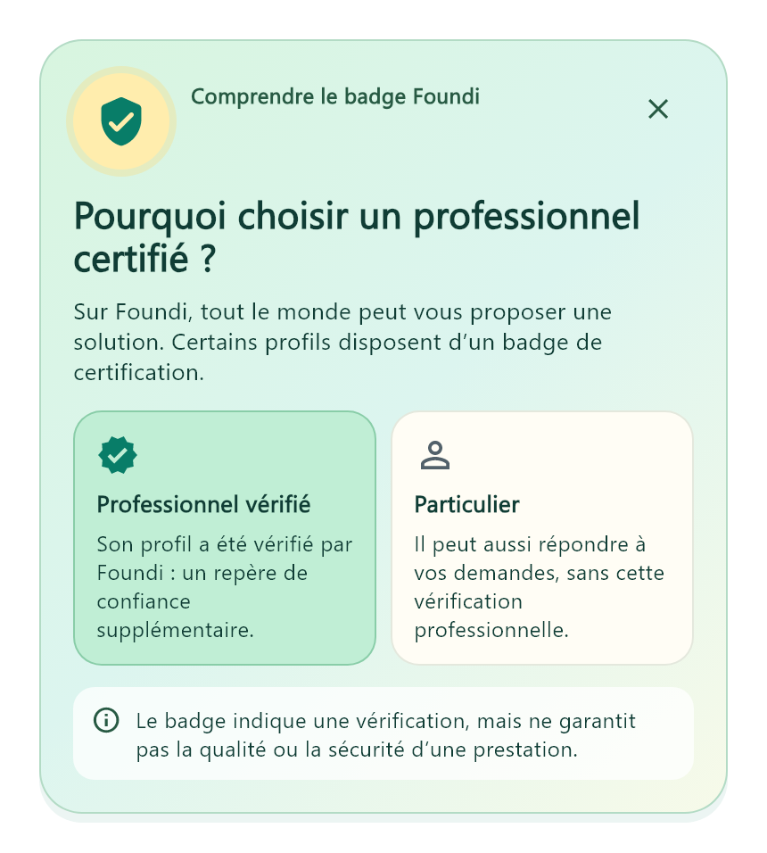

# Foundi V1 — Réponses des particuliers et badge professionnel

Intervention du 20 novembre 2026, sur `codex/reponses-particuliers-badge-carte`, dans le dépôt local `C:\laragon\www\foundi`.

## Périmètre et état initial

La branche a été créée avant l’implémentation. Les références distantes ont été récupérées avec `git fetch origin` ; aucun pull, reset, commit ou push n’a été effectué. Le déploiement backend a ensuite été autorisé et réalisé : voir le [compte rendu de déploiement](deploiement-backend.md). Le travail part du code local, y compris ses changements non commités. Une copie des fichiers initialement modifiés a été conservée dans `.dart_tool/responders-baseline` pour distinguer cette intervention des travaux Android, confidentialité, site public et performances déjà présents.

## Comportement implémenté

### Flutter et interface

- Un compte ordinaire peut utiliser « Répondre », composer sa proposition, retrouver son historique et discuter avec l’auteur. L’accès est confirmé par le serveur à chaque envoi.
- « Mes réponses » est disponible dans Messages pour tous les comptes. Le compte donne également accès aux propositions envoyées.
- Les listes de répondants et les textes des décisions parlent de personnes ou de répondants. Les professionnels non approuvés utilisent leur nom de compte public et aucun badge.
- Le bouton de profil professionnel dans le détail d’une réponse est affiché seulement après confirmation de la certification actuelle. Une validation ou révocation ultérieure met aussi ce bouton à jour.
- Le badge partagé est présent dans les répondants, les propositions, le contexte de conversation côté auteur, les profils professionnels et l’annuaire. Un toucher ouvre l’explication et la réserve de non-garantie.
- La carte pédagogique est placée après la première demande d’Explorer. Cela garde une demande accessible avant la carte et conserve les abonnements, filtres et mécanismes de pagination existants. Sa fermeture dure pendant la vie de la vue Explorer conservée dans la session ; une nouvelle vue peut la réafficher.
- La carte utilise un dégradé menthe/turquoise, des coins de 24 dp, un médaillon de bouclier doré, deux blocs comparatifs et un bandeau de transparence. À faible largeur ou avec de grandes polices, les blocs passent en colonne. Aucun package n’a été ajouté. L’application existante utilise un thème clair ; cette intervention ne crée pas un nouveau mode sombre.



La capture est un rendu du widget Flutter, pas une maquette. Les tests couvrent 320 et 430 dp, avec des facteurs de texte de 1 et 2.

### Backend et sécurité

Le droit de répondre aux demandes publiques ne dépend plus de `professionalProfiles.status`. Restent appliqués : authentification, utilisateur Auth non désactivé, email confirmé, restrictions de compte, suppression de compte en cours, blocages dans les deux sens, demande publiée, miroir privé cohérent et interdiction de répondre à sa propre demande.

Les demandes directes restent réservées au professionnel choisi et approuvé. Ouvrir une discussion ou retenir une réponse publique vérifie l’éligibilité générale du répondant. Un auteur peut refuser une réponse même si la relation est bloquée ; une retenue ou un nouveau message ne contourne pas ce blocage.

L’identifiant déterministe de proposition demeure le SHA-256 de `requestId + '\0' + uid`. Une transaction crée la réponse et incrémente une seule fois le compteur privé. Les protections existantes contre doublons, réessais concurrents, champs forgés et messages à identité usurpée sont conservées. Il n’existait pas de quota quotidien spécifique aux propositions dans ce service ; aucun quota existant n’a été supprimé ou étendu. Les quotas des recommandations, publications, pièces jointes et notifications restent dans leurs services existants.

Les noms des particuliers réutilisent `accountRequesterName`, qui refuse notamment emails, numéros de téléphone et caractères de contrôle. Les données de compte privées ne sont pas renvoyées par la liste publique des répondants.

### Données et rétrocompatibilité

| Document | Identité et nom du répondant |
| --- | --- |
| Ancienne proposition ou conversation | Lecture de `professionalUid` et `professionalName` si les champs neutres sont absents. |
| Nouvelle réponse ordinaire ou professionnel non approuvé | `responderUid` et `responderName` uniquement ; aucun `professionalUid` attribué artificiellement. |
| Nouvelle réponse d’un professionnel approuvé | Champs neutres et anciens champs professionnels, avec des valeurs identiques pour conserver les lectures existantes. |
| Nouvelle conversation | Champs neutres, participants inchangés ; alias professionnels seulement si le profil est approuvé à sa création. |

L’identité canonique côté serveur est `responderUid`, avec repli de lecture sur `professionalUid`. Les anciens champs restent immuables dans les documents existants et ne constituent jamais une preuve actuelle de certification. Les propriétés historiques des modèles Flutter et `retainedProfessionalName` restent compatibles ; ce dernier contient le nom d’affichage de la réponse retenue et n’attribue aucun rôle ni badge.

Les abonnements des propositions envoyées et des conversations utilisent une seule requête OR sur les deux schémas. Firestore déduplique les documents contenant les deux champs. Les répondants publics sont paginés par identifiant de document, avec projection des seuls champs utiles ; une réponse sans champ professionnel est donc incluse. Les index historiques sont conservés et leurs équivalents `responderUid` ajoutés.

Aucune migration destructive n’est nécessaire. La suppression de compte recherche les deux schémas, efface les réponses de l’utilisateur, pseudonymise son identité dans les conversations et conserve l’historique de l’autre participant. Les avatars, signalements, pièces jointes et suppressions personnelles de conversations utilisent la même identité canonique.

### Conditions exactes du badge

La source de vérité est le statut serveur `professionalProfiles/{uid}.status == 'approved'`, issu du circuit de validation administrative existant. Un rôle déclaré, une demande de validation, un métier, les anciens champs professionnels ou une valeur envoyée par le client ne suffisent jamais.

Les nouvelles vérifications groupées exigent aussi un compte Auth existant, avec email confirmé et non désactivé, sans suspension `accountSafety`, sans suppression `accountLifecycle` et sans masquage `safetyContent/professional_{uid}`. Les vérifications des profils et de l’annuaire conservent leurs contrôles fiables existants.

Une liste de propositions utilise un appel groupé pour au plus 30 propositions. Les répondants sont résolus par lots côté serveur, y compris leurs avatars publics ; Flutter ne crée pas de listener Firestore par répondant pour calculer le badge ou la version d’avatar. Les listes et détails de réponses revérifient les badges toutes les 45 secondes et au retour de l’application. Les badges sont masqués pendant une nouvelle vérification, en arrière-plan ou en cas d’échec. La fraîcheur est bornée par ce délai, ce n’est pas une révocation instantanée par listener. La pagination de rafraîchissement s’arrête aussi lorsqu’une réponse réseau arrive après le délai global.

Le libellé explicatif est « Profil professionnel vérifié par Foundi », accompagné de « Le badge indique une vérification, mais ne garantit pas la qualité ou la sécurité d’une prestation. »

### Firebase, notifications et annuaire

- Les règles Firestore autorisent uniquement l’auteur et le répondant à lire leur proposition ou conversation, via l’un des deux schémas. Toutes les écritures clientes de propositions, conversations et messages restent interdites. Les autres collections ne sont pas ouvertes.
- Les règles Storage n’ont pas changé : les lectures et écritures de pièces jointes passent toujours par les endpoints sécurisés et leurs contrôles de participation.
- Les événements de proposition, discussion, décision, message et clôture utilisent le répondant canonique. Les identifiants d’événements et la déduplication existants sont conservés. La résolution des notifications de clôture retrouve aussi les anciennes propositions dont l’identifiant ne suit pas le schéma déterministe actuel.
- Les messages restent séparés des notifications générales. Leurs reçus, aperçus et préférences existants sont conservés.
- Le nom affiché dans une proposition ou un aperçu de message provient du nom public du compte pour un répondant ordinaire. Le nom d’un dossier professionnel en attente ou révoqué n’est pas utilisé comme nom public professionnel.
- Les recherches et fiches d’annuaire restent contrôlées par les services professionnels existants et les profils approuvés/admissibles. Les propositions publiques n’ouvrent aucun accès à une fiche professionnelle en attente ou rejetée.
- Les opportunités ciblées conservent leur recherche de profils approuvés et leurs conditions de catégories, spécialités, zones, préférences et éligibilité. Aucun élargissement aux comptes particuliers n’a été réalisé.

## Vérifications

Les résultats finaux et la liste exacte des fichiers figurent ci-dessous. Les journaux locaux sont dans `.dart_tool/responders-*.log` ; les premières passes comportaient des attentes historiques « professionnel obligatoire », corrigées et revérifiées.

Le lanceur `flutter.bat` est resté bloqué sur son verrou SDK dans cet environnement. Les tests Flutter ont donc été exécutés avec le moteur installé. Une analyse Flutter complète a réussi ; l’analyse finale des derniers ajustements a été exécutée directement avec Dart et la configuration `analysis_options.yaml` du projet, sans problème détecté :

```powershell
$sdk = 'C:\src\flutter_windows_3.24.0-stable\flutter'
$dart = "$sdk\bin\cache\dart-sdk\bin\dart.exe"
$flutterTools = "$sdk\bin\cache\flutter_tools.snapshot"
& $dart $flutterTools test --no-pub
& $dart $flutterTools analyze --no-pub
& $dart analyze
& $dart $flutterTools test --no-pub --concurrency=1 test/ordinary_responder_test.dart test/request_respondents_test.dart test/proposals_v7_test.dart test/negotiation_v81_test.dart
& $dart $flutterTools test --no-pub --dart-define=CAPTURE_RESPONDER_CARD=true test/ordinary_responder_test.dart
npm.cmd --prefix functions test
node --test --test-concurrency=1 functions/test/*.test.js
npm.cmd --prefix functions run check
npm.cmd --prefix functions run test:responders:emulators
```

La recette Firebase utilise uniquement le projet local `demo-foundi` et des ports sélectionnés dynamiquement. Les tests de règles précèdent les scénarios d’intégration. Le runtime Java de règles imprime un avertissement de fermeture après l’arrêt des émulateurs ; la seconde recette a terminé avec un code 0, sans échec de test.

| Vérification exécutée | Résultat |
| --- | --- |
| Suite complète Flutter | 294 tests réussis, aucun échec. |
| Flutter ciblé final en séquence | 22 tests réussis, aucun échec, avec les tests supplémentaires du repository applicatif et d’approbation/révocation du lien de profil. Ce nombre recoupe la suite complète. |
| Analyse Flutter | Aucun problème détecté. |
| Suite Node complète finale en séquence | 260 tests réussis, aucun échec, aucun test ignoré. |
| `npm run check` | Code de sortie 0. |
| Règles Firebase dans les émulateurs | 42 tests réussis, aucun échec ou test ignoré. |
| Intégration Firebase sélectionnée | 12 scénarios réussis, aucun échec ou scénario ignoré ; code final 0. |
| `git diff --check` | Code de sortie 0. |

Le parcours d’intégration ajouté exécute réellement les callables et les règles : particuliers, professionnel approuvé, compte en attente, visiteur, email non confirmé, auto-réponse interdite, envois concurrents, propositions concurrentes privées, usurpation de champs, répondants mixtes, ancien document avec seulement `professionalUid`, décisions, conversation et messages, reçus/notifications dédupliqués, blocage, révocation et clôture. Il vérifie aussi la suppression des réponses particulières et la pseudonymisation de leur conversation sans effacer les messages de l’autre personne. Les scénarios existants d’annuaire, notifications, sécurité, avatars et suppression personnelle des conversations ont également été exécutés.

Les tests Flutter ajoutés couvrent les modèles neutres/historiques, la vérification groupée des listes, le retrait du badge, son explication, le lien de profil conditionné par une certification actuelle, le raccordement du repository principal au callable groupé, les réponses réseau tardives, le petit écran, les grandes polices, la fermeture de la carte et sa capture. Une passe parallèle tardive a épuisé la mémoire de l’environnement ; la relance finale avec `--concurrency=1` a réussi. Le dernier test Node confirme aussi qu’un nom de dossier professionnel en attente ou révoqué n’est pas utilisé comme identité publique pour les propositions et aperçus de message.

## Recette manuelle et décision

GO pour la recette de cette évolution. La publication reste NO-GO tant que les vérifications sur appareils et l’ordre de mise en service n’ont pas été validés :

1. Sur Android, avec auteur, particulier, professionnel approuvé et profil en attente : envoyer, consulter, retenir/refuser, discuter, revenir depuis Messages et clôturer.
2. Vérifier les notifications FCM sur un appareil réel, au premier plan et en arrière-plan ; les émulateurs valident les événements persistés, pas la livraison native par les services push.
3. Révoquer une certification depuis l’administration et contrôler le retrait du badge, l’accès à son explication et l’exclusion de l’annuaire/opportunités. Le contrôle périodique introduit une fenêtre maximale de 45 secondes pour les nouvelles surfaces de réponse.
4. Vérifier le scroll sur petit écran, avec clavier et grandes polices, la fermeture de la carte, le retour dans Explorer et la restitution des filtres.
5. Les index, règles et fonctions compatibles ont été déployés sur autorisation. Il reste à mettre à disposition et valider le client compatible. Les anciens clients qui exigent un `professionalUid` ne peuvent pas interpréter une nouvelle réponse particulière ; la coordination de version est nécessaire. Ne pas revenir à un backend ancien sur des données neutres déjà créées sans prévoir leur traitement.

Le déploiement Firebase autorisé est terminé, selon le [compte rendu dédié](deploiement-backend.md). Aucun APK signé, build iOS, publication Play Store ou livraison FCM réelle de test n’a été réalisé pendant cette intervention. Les fichiers natifs, secrets et changements de préparation de publication préexistants restent hors périmètre.

## Fichiers de cette intervention

Cette liste exclut les modifications préexistantes restées identiques. Les fichiers signalés « déjà modifié » contiennent aussi du travail local antérieur, conservé.

| Fichier | Rôle | État initial |
| --- | --- | --- |
| `docs/evolutions-v1/carte-badge.png` | Capture du widget Flutter effectivement rendu. | Ajouté |
| `docs/evolutions-v1/reponses-particuliers.md` | Contrats, périmètre, validation et recette de cette évolution. | Ajouté |
| `firestore.indexes.json` | Index neutres ajoutés, index historiques conservés. | Suivi, sans modification locale initiale |
| `firestore.rules` | Lectures réservées aux participants pour les deux schémas. | Suivi, sans modification locale initiale |
| `functions/integration-test/ordinary-responder-flow.test.cjs` | Tests fonctionnels, de sécurité ou de non-régression du parcours concerné. | Ajouté |
| `functions/integration-test/proposal-flow.test.cjs` | Tests fonctionnels, de sécurité ou de non-régression du parcours concerné. | Suivi, sans modification locale initiale |
| `functions/integration-test/request-interaction-flow.test.cjs` | Tests fonctionnels, de sécurité ou de non-régression du parcours concerné. | Déjà modifié |
| `functions/package.json` | Commandes de recette dédiées et vérifications syntaxiques. | Suivi, sans modification locale initiale |
| `functions/rules-test/conversations.test.cjs` | Tests fonctionnels, de sécurité ou de non-régression du parcours concerné. | Suivi, sans modification locale initiale |
| `functions/rules-test/proposals.test.cjs` | Tests fonctionnels, de sécurité ou de non-régression du parcours concerné. | Suivi, sans modification locale initiale |
| `functions/scripts/test-v82-emulators.cjs` | Recette locale des règles et parcours concernés. | Déjà modifié |
| `functions/src/conversation-avatar-service.js` | Résolution des avatars des participants neutres. | Suivi, sans modification locale initiale |
| `functions/src/conversation-deletion-service.js` | Suppression personnelle pour les participants neutres. | Suivi, sans modification locale initiale |
| `functions/src/conversation-service.js` | Discussions, décisions et messages pour les deux types de répondants. | Déjà modifié |
| `functions/src/index.js` | Exposition du callable groupé de certification. | Suivi, sans modification locale initiale |
| `functions/src/notification-service.js` | Destinataires neutres et résolution compatible des historiques. | Suivi, sans modification locale initiale |
| `functions/src/privacy-purge.js` | Découverte, suppression et pseudonymisation des deux schémas. | Suivi, sans modification locale initiale |
| `functions/src/professional-showcase-service.js` | Accès professionnel via une proposition compatible. | Suivi, sans modification locale initiale |
| `functions/src/proposal-certification-service.js` | Vérification privée et groupée du statut actuel des répondants. | Ajouté |
| `functions/src/proposal-service.js` | Autorisation ordinaire, nom public sûr et écriture compatible. | Suivi, sans modification locale initiale |
| `functions/src/request-respondents-service.js` | Liste publique mixte, projection et contrôles par lots. | Suivi, sans modification locale initiale |
| `functions/src/responder.js` | Identité canonique, repli historique et critères de profil approuvé. | Ajouté |
| `functions/src/safety-service.js` | Signalements et blocages à partir de la bonne identité. | Suivi, sans modification locale initiale |
| `functions/test-support/backend-loading-fixtures.js` | Fixture des lectures réellement groupées et des restrictions. | Suivi, sans modification locale initiale |
| `functions/test/backend-loading.test.js` | Tests fonctionnels, de sécurité ou de non-régression du parcours concerné. | Suivi, sans modification locale initiale |
| `functions/test/negotiation-service.test.js` | Tests fonctionnels, de sécurité ou de non-régression du parcours concerné. | Suivi, sans modification locale initiale |
| `functions/test/ordinary-responder.test.js` | Tests fonctionnels, de sécurité ou de non-régression du parcours concerné. | Ajouté |
| `functions/test/proposal-service.test.js` | Tests fonctionnels, de sécurité ou de non-régression du parcours concerné. | Suivi, sans modification locale initiale |
| `lib/features/conversations/data/firebase_conversation_repository.dart` | Historique de réponses par requête OR unique. | Suivi, sans modification locale initiale |
| `lib/features/conversations/domain/conversation_repository.dart` | Modèle compatible des participants et noms. | Suivi, sans modification locale initiale |
| `lib/features/conversations/presentation/conversation_views.dart` | Onglet Mes réponses, participation et contexte du badge. | Déjà modifié |
| `lib/features/conversations/presentation/proposal_negotiation.dart` | Libellés de décision neutres. | Suivi, sans modification locale initiale |
| `lib/features/navigation/presentation/foundi_shell.dart` | Accès aux réponses et conversations pour tous les comptes. | Suivi, sans modification locale initiale |
| `lib/features/professional/presentation/professional_badge.dart` | Badge partagé, explication et carte pédagogique. | Ajouté |
| `lib/features/professional/presentation/professional_directory_view.dart` | Réutilisation du badge dans les cartes déjà validées. | Suivi, sans modification locale initiale |
| `lib/features/professional/presentation/professional_profile_widgets.dart` | Réutilisation du badge dans les profils. | Suivi, sans modification locale initiale |
| `lib/features/proposals/data/firebase_proposal_repository.dart` | Requêtes OR et appel groupé de certification. | Suivi, sans modification locale initiale |
| `lib/features/proposals/domain/proposal_repository.dart` | Modèle neutre et contrat de vérification groupée. | Suivi, sans modification locale initiale |
| `lib/features/proposals/presentation/proposal_certifications.dart` | Contrôle groupé, rafraîchissement et retrait des badges périmés. | Ajouté |
| `lib/features/proposals/presentation/proposal_views.dart` | Réponse ordinaire, noms neutres et badges dans listes/détails. | Déjà modifié |
| `lib/features/requests/data/firebase_request_repository.dart` | Répondants mixtes, avatars publics et délégation de la certification groupée exposée à l’application. | Suivi, sans modification locale initiale |
| `lib/features/requests/domain/request_repository.dart` | Modèle public de répondant avec certification explicite. | Suivi, sans modification locale initiale |
| `lib/features/requests/presentation/explorer_view.dart` | Carte après la première demande et fermeture de session. | Suivi, sans modification locale initiale |
| `lib/features/requests/presentation/request_respondents.dart` | Affichage mixte, avatars sans listener par ligne et rafraîchissement. | Suivi, sans modification locale initiale |
| `lib/features/requests/presentation/request_views.dart` | Texte des cartes et du suivi cohérent avec les réponses ouvertes à la communauté. | Suivi, sans modification locale initiale |
| `test/conversation_cards_test.dart` | Tests fonctionnels, de sécurité ou de non-régression du parcours concerné. | Suivi, sans modification locale initiale |
| `test/conversations_v8_test.dart` | Tests fonctionnels, de sécurité ou de non-régression du parcours concerné. | Suivi, sans modification locale initiale |
| `test/negotiation_v81_test.dart` | Tests fonctionnels, de sécurité ou de non-régression du parcours concerné. | Suivi, sans modification locale initiale |
| `test/opportunities_v6_test.dart` | Tests fonctionnels, de sécurité ou de non-régression du parcours concerné. | Suivi, sans modification locale initiale |
| `test/ordinary_responder_test.dart` | Tests fonctionnels, de sécurité ou de non-régression du parcours concerné. | Ajouté |
| `test/proposals_v7_test.dart` | Tests fonctionnels, de sécurité ou de non-régression du parcours concerné. | Suivi, sans modification locale initiale |
| `test/public_professional_profile_test.dart` | Tests fonctionnels, de sécurité ou de non-régression du parcours concerné. | Suivi, sans modification locale initiale |
| `test/request_actions_test.dart` | Tests fonctionnels, de sécurité ou de non-régression du parcours concerné. | Suivi, sans modification locale initiale |
| `test/request_respondents_test.dart` | Tests fonctionnels, de sécurité ou de non-régression du parcours concerné. | Suivi, sans modification locale initiale |
