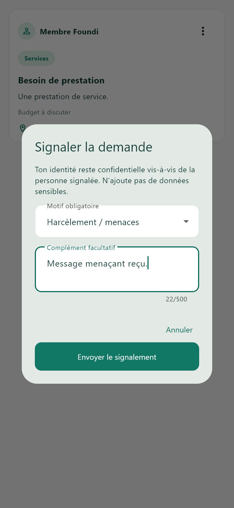
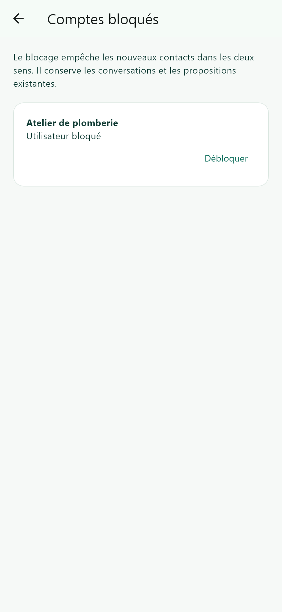
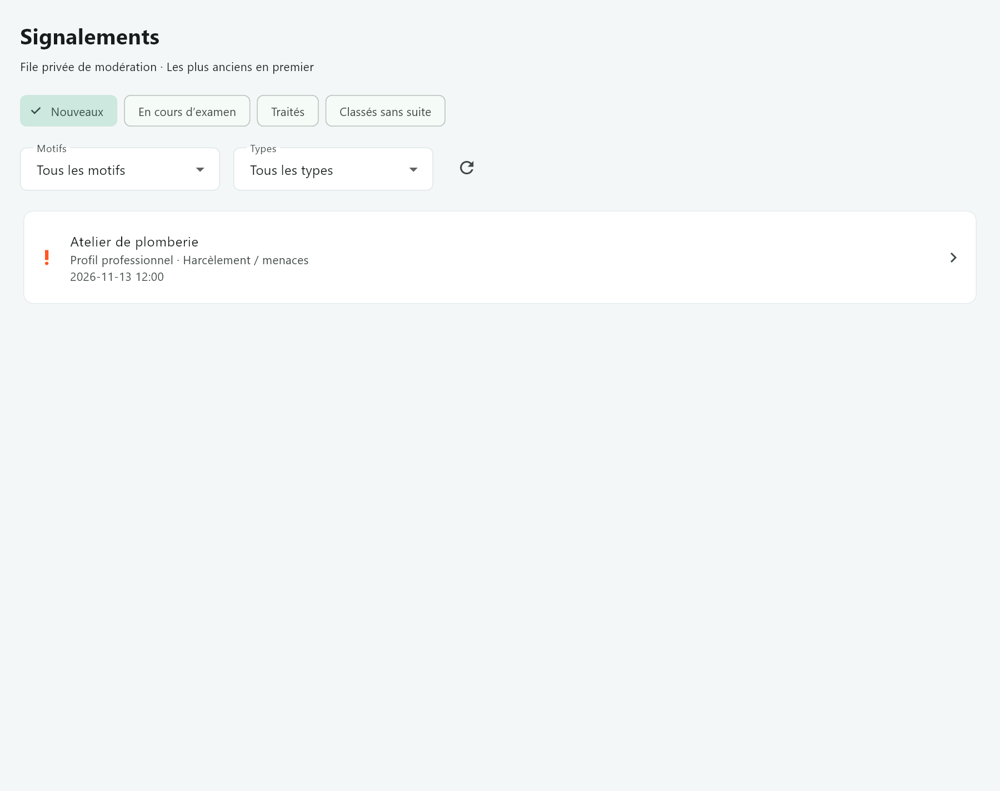
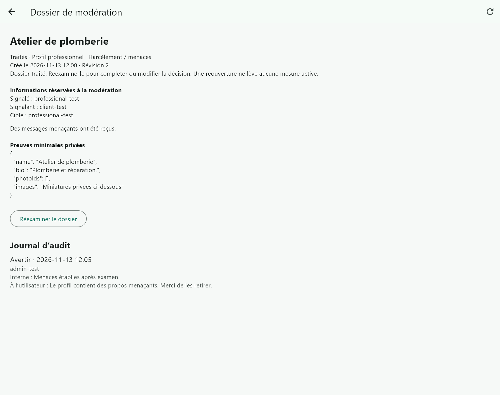

# Captures réelles du Sprint 1

Rendus réels des widgets Flutter de l’application et de Foundi Admin, avec données de test et polices chargées. Ces images ont été générées pendant les tests `SAFETY_CAPTURE=true`. Elles ne représentent pas une base de production et ne sont pas des maquettes.

| Application | Capture |
| --- | --- |
| Menu de demande | [01-menu-demande.png](01-menu-demande.png) |
| Formulaire | [02-formulaire-signalement.png](02-formulaire-signalement.png) |
| Comptes bloqués | [03-comptes-bloques.png](03-comptes-bloques.png) |
| Menu de conversation | [04-menu-conversation.png](04-menu-conversation.png) |
| Historique après blocage | [05-conversation-bloquee.png](05-conversation-bloquee.png) |
| Menu du profil public | [06-menu-profil.png](06-menu-profil.png) |
| Aide et règles de conduite | [07-aide-regles.png](07-aide-regles.png) |
| File Admin | [08-admin-file.png](08-admin-file.png) |
| Détail privé Admin | [09-admin-detail.png](09-admin-detail.png) |
| Audit Admin | [10-admin-audit.png](10-admin-audit.png) |
| Examen en cours | [11-admin-examen-en-cours.png](11-admin-examen-en-cours.png) |
| Avis de modération | [12-notification-moderation.png](12-notification-moderation.png) |
| Réexamen et historique | [13-admin-reexamen.png](13-admin-reexamen.png) |
| Message utilisateur et justification interne | [14-admin-message-utilisateur.png](14-admin-message-utilisateur.png) |
| Identification de la publication | [15-avis-contenu-concerne.png](15-avis-contenu-concerne.png) |
| Confirmation de lecture | [16-avis-fermeture.png](16-avis-fermeture.png) |
| Historique après fermeture | [17-historique-avis-ferme.png](17-historique-avis-ferme.png) |

